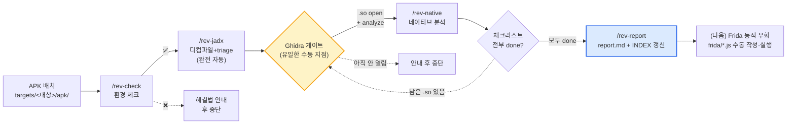
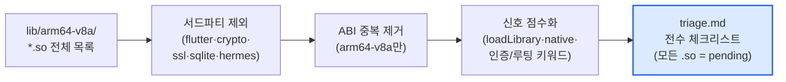
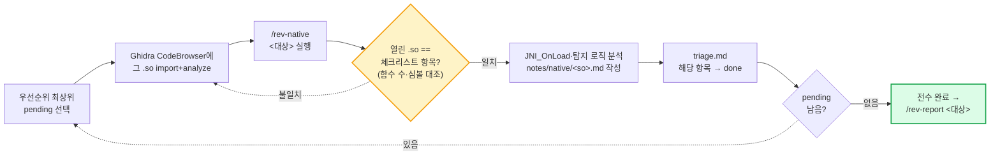

# revkit

모바일 APK 리버싱 자동분석 툴킷. 파이프라인: **jadx**(Java 디컴파일·triage) → **Ghidra**(MCP로 네이티브 `.so`) → **Frida**(동적 우회, 예정).

분석은 Claude Code 슬래시 커맨드(`/rev-*`)로 구동한다. 상세 워크플로우(개념·설치·트러블슈팅)는 [`docs/`](docs/)의 워크플로우 문서 참조.

> **전제**: 인가된(authorized) 모의해킹·보안 평가에서만 사용한다. 대상 앱·범위가 계약서/업무지시서에 명시되어 있는지, 디컴파일 결과를 외부(클라우드 LLM 포함)로 전송해도 되는지 사전 확인한다.

## 이 툴킷이 하는 일

- **Java단**: jadx로 디컴파일 후 `System.loadLibrary`/`native` 선언을 전수 추적해 "어떤 `.so`가 인증·방어 로직을 담고 있는지" 특정(triage).
- **네이티브단**: triage로 추려진 `.so`를 Ghidra(MCP)로 열어 `JNI_OnLoad`·탐지 함수·분기 로직을 리네임·코멘트하며 분석.
- **문서화**: 단계별 결과를 `targets/<대상>/notes/*.md`로 남기고 최종 `report.md`로 종합. 대상이 여러 개면 `targets/INDEX.md`에서 전체를 한눈에 추적.
- **(다음 단계) 동적 우회**: 정적 분석으로 찾은 분기 좌표를 Frida로 런타임 후킹해 실제 우회 검증(`frida/` 스크립트는 수동 작성·실행).

## APK는 어디에 놓나

대상마다 폴더를 하나 만들고, 그 밑 `apk/`에 원본 파일을 넣는다. **이 한 곳이 모든 입력의 시작점**이다.

```
targets/<대상>/apk/<파일명>.apk        # 또는 .zip
```

- 파일명은 자유(디컴파일 명령에서 직접 참조하므로 상관없음), 폴더 구조만 지키면 된다.
- 압축을 미리 풀어둘 필요 없음 — jadx는 APK를 그대로 받아 내부 dex를 자동 처리하고, Ghidra도 APK를 Filesystem Browser로 직접 열 수 있다.
- `/rev-jadx`가 `--no-res`로 돌기 때문에(가벼운 Java-only triage) `.so`는 jadx 출력에 포함되지 않는다. Ghidra용 `.so`는 `targets/<대상>/unpacked/lib/arm64-v8a/`에 미리 압축 해제해두거나, APK에서 별도 추출해 그 경로에 둔다.
- `apk/`, `unpacked/`, `jadx-out/`, `ghidra/`는 전부 `.gitignore` 대상이다 — 바이너리·디컴파일 결과는 로컬에만 남고 git에는 올라가지 않는다.

## 전체 파이프라인 흐름



`/rev-all <대상>` 한 줄은 위 A~G를 순서대로 돌리되, **D(Ghidra 게이트)에서만 멈춰** 사람 개입을 요청한다. 노란 박스가 유일한 수동 지점이고 나머지는 자동이다.

## 빠른 시작 (실제 타이핑 순서)

새 앱 `testapp`을 분석한다고 하면:

```
1) APK 배치:  targets/testapp/apk/testapp.apk   (폴더에 .apk 넣기)

2) 한 줄로 전체 실행:
   /rev-all testapp          # 환경체크 → jadx 디컴파일 + triage 까지 자동 진행
                             # 네이티브 직전(Ghidra 수동 지점)에서 멈춤

3) Ghidra CodeBrowser에 타깃 .so 열기 (import + analyze)
   so 위치: targets/testapp/unpacked/lib/arm64-v8a/<타깃>.so

4) 이어서:
   /rev-native testapp       # 네이티브 .so 분석 (여러 개면 하나씩 전수)
   /rev-report testapp       # 종합 보고서 + INDEX 갱신
```

### 핵심 규칙
- **`/rev-all testapp`은 한 번만** 친다. 뒤에 `/rev-check`·`/rev-jadx`를 이어 치는 게 아니라, rev-all이 내부에서 그 단계를 돌린다.
- **대상명은 커맨드마다 매번 쓴다.** 슬래시 커맨드는 이전 대상명을 기억하지 못한다 → `/rev-native testapp`, `/rev-report testapp` 처럼 항상 뒤에 붙인다.
- **Ghidra 지점에서만 수동 개입.** 나머지는 자동이다.

## `.so`가 여러 개일 때 — 분석 순서를 정하는 방법

하나의 APK에서 `.so`가 수십 개 나오는 건 흔하다(React Native, OpenSSL, Fresco 등 서드파티 다수 포함). 이 중 실제로 볼 가치가 있는 건 보통 1~3개뿐이고, **빠짐없이 + 정확하게** 처리하려면 "눈에 보이는 대로 하나씩"이 아니라 아래 순서를 따른다.

**1) 전수 목록화·우선순위 매기기 (한 번만)**



**2) `.so` 하나씩 처리 (pending이 없어질 때까지 반복)**



### 1단계 — 전수 목록화 (누락 방지의 핵심)
`/rev-jadx`가 Java triage를 돌리면서 `targets/<대상>/notes/triage.md` 맨 아래에 **`.so` 전수 체크리스트**를 만든다. 이게 이후 모든 단계의 기준표다:

| `.so` | 신호(인증/암호/anti-tamper) | 우선순위 | 상태 |
| --- | --- | --- | --- |
| libfoomonitor.so | 루팅/디버거 탐지 문자열, JNI export 5개 | 높음 | pending |
| libcrypto.so | OpenSSL(서드파티) | 제외 | - |
| ... | ... | ... | ... |

이 표에 없는 `.so`가 나중에 발견되면 **빠짐없이** 다시 추가한다 — 중간에 임의로 건너뛰지 않는다.

### 2단계 — 우선순위 기준 (어떤 걸 먼저/나중에 볼지)
- **서드파티부터 제외**: `libflutter.so`, `libreactnative.so`, `libcrypto.so`/`libssl.so`(OpenSSL), `libsqlite.so`, `libhermes*.so` 같은 공개 라이브러리는 로직이 공개돼 있으므로 분석 대상에서 뺀다. 앱 패키지명스러운 이름·난독화된 이름이 진짜 타깃.
- **ABI 중복 제거**: `lib/` 밑 `arm64-v8a`/`armeabi-v7a`/`x86_64`는 같은 로직의 CPU별 복사본이다. **arm64-v8a 하나만** 분석(나머지는 체크리스트에서 "중복 제외"로 명시해 혼동 방지).
- **신호 점수화**: `System.loadLibrary`/`native` 선언이 몰려 있는 클래스명, 인증·OTP·루팅·무결성·디버거 관련 키워드, JNI export 개수로 우선순위를 매긴다. 신호가 강한 `.so`부터 높은 우선순위.

### 3단계 — 한 번에 하나씩, 순서대로 (정확성의 핵심)
Ghidra CodeBrowser는 한 번에 하나의 `.so`만 열어서 분석하는 구조이므로, 여러 `.so`를 동시에 "대충" 보는 게 아니라 **우선순위 높은 것부터 하나씩 끝까지** 본다:

1. `/rev-native <대상>` 실행 전, triage.md 체크리스트에서 우선순위가 가장 높은 `pending` 항목을 확인.
2. 그 `.so`를 Ghidra CodeBrowser에 import + analyze로 열어둔다.
3. `/rev-native <대상>`을 실행하면 — 현재 열린 `.so`가 체크리스트의 어느 항목인지 **함수 수·심볼로 먼저 대조**(엉뚱한 `.so`를 분석하는 사고 방지) → `JNI_OnLoad`/`RegisterNatives`로 네이티브↔Java 매핑 → 탐지/방어 로직 분석 → 결과를 `notes/native/<so이름>.md`에 1파일로 기록 → **triage.md의 해당 항목을 `done`으로 갱신**.
4. 체크리스트에 `pending`이 남아 있으면, "다음은 `<so>` — CodeBrowser에 그거 열고 `/rev-native <대상>` 재실행"으로 안내받는다. 이 안내를 따라 **한 세션에 하나씩** 반복.
5. 체크리스트 전체가 `done`이 되어야 `/rev-report <대상>`로 종합 보고서를 만든다 — 하나라도 `pending`이면 report가 불완전하다는 신호다.

이 방식의 핵심은 **triage.md의 전수 체크리스트가 유일한 진행 상태 기준**이라는 점이다. "다 본 것 같다"는 감으로 멈추지 않고, 체크리스트에 `pending`이 하나도 없을 때까지가 "완료"의 정의다.

## 커맨드

| 커맨드 | 역할 |
| --- | --- |
| `/rev-check <대상>` | 사전 환경 체크 (MCP·Ghidra·APK·Java·jadx 버전) |
| `/rev-jadx <대상>` | jadx 완전 자동 디컴파일 + Java triage (`triage.md`, `java_analysis.md`) |
| `/rev-native <대상>` | Ghidra MCP 네이티브 분석 (`.so` 전수 순회 → `notes/native/<so>.md`) |
| `/rev-report <대상>` | 단계별 노트 종합 → `report.md` + `INDEX.md` 갱신 |
| `/rev-all <대상>` | 위 전체를 순서대로 (Ghidra 수동 지점에서만 멈춤) |

- `<대상>` = `targets/` 밑 폴더 이름 (예: `testapp`, `scn00`).
- 단계를 따로 돌리고 싶으면 개별 커맨드를 `/rev-jadx testapp` 처럼 직접 호출한다.

## 구조

```
revkit/
├─ .claude/commands/   /rev-* 슬래시 커맨드
├─ docs/               워크플로우 문서
├─ .gitignore          바이너리·민감파일·로컬 설정 제외 (notes·frida만 커밋)
├─ .mcp.json.example   Ghidra MCP 연결 설정 템플릿 (실제 .mcp.json은 로컬 전용, gitignore)
└─ targets/
   ├─ INDEX.md         대상 전체 한눈표
   └─ <대상>/
      ├─ apk/ unpacked/ jadx-out/ ghidra/   (gitignore)
      ├─ frida/   (커밋)
      └─ notes/   (커밋) triage.md(전수 체크리스트 포함) · java_analysis.md · native/<so>.md · report.md
```

> 분석 대상 APK·`.so`·디컴파일 결과는 git에 올리지 않는다(`.gitignore`). 분석 노트(`notes/`)와 Frida 스크립트만 커밋한다.

## 처음 clone 했을 때 — Ghidra MCP 설정

`.mcp.json`은 로컬 사용자명·설치 경로가 그대로 들어가는 머신 전용 파일이라 git에는 올리지 않는다(`.gitignore`). 대신 템플릿 `.mcp.json.example`을 복사해 자기 환경에 맞게 채운다:

```
cp .mcp.json.example .mcp.json
# .mcp.json 안의 <사용자명>을 본인 Windows 사용자명으로, 포트/경로를 본인 Ghidra 설치에 맞게 수정
```

`claude` 실행 시 "New MCP server found" 승인 창이 뜨면 "Use this MCP server"를 선택해야 연결된다.
