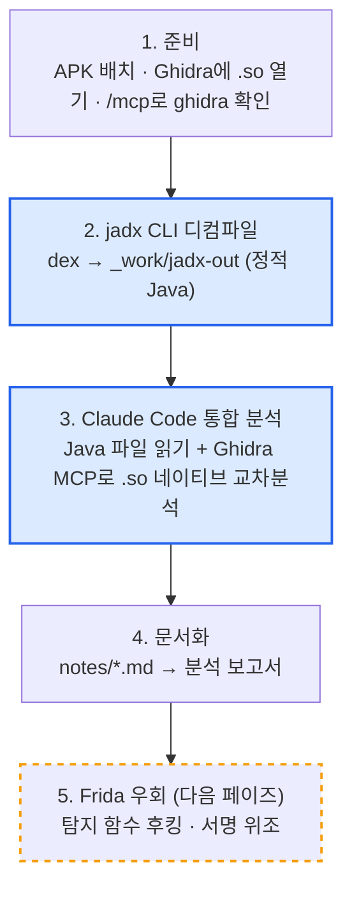

# APK 리버싱 워크플로우: jadx → Ghidra → MCP → Frida

Nov 9, 2026 · @chuaoi

## 범위 및 전제

이 문서는 **인가된(authorized) 모의해킹·보안 평가**를 전제로 한 Android APK 리버싱 방법론이다. 분석 전 반드시 확인한다.

- 대상 앱·범위(scope)가 계약서/업무지시서에 명시되어 있는지
- NDA 및 데이터 취급 조건 — 특히 디컴파일 결과를 외부(클라우드 LLM 포함)로 전송해도 되는지
- 민감 샘플은 격리된 분석 VM에서 다루고, 실제 운영 계정·실데이터로 테스트하지 않는지

MCP 연동 시 디컴파일 코드가 Claude(클라우드)로 전송되므로, 범위 외 자산이나 고객 비밀이 포함된 바이너리는 폐쇄망 구성 또는 로컬 모델 사용을 검토한다.

## 전체 파이프라인 개요

APK 리버싱은 한 도구로 끝나지 않고, **Java단 → 네이티브단 → 자동화 → 런타임 우회**의 4단계로 흐른다. 각 단계가 다음 단계의 입력을 만든다.


 

1. **jadx (Java단 triage)** — APK를 열어 `loadLibrary`/`native` 호출을 추적해 **어떤 `.so`가 인증·방어 로직을 담고 있는지 특정**한다. 전체 지도를 그리는 단계.
2. **Ghidra (네이티브 분석)** — 특정된 `.so`(arm64-v8a)를 import해 디컴파일하고, 함수 호출·xref를 따라가며 `if` 분기 로직을 읽는다.
3. **MCP (자동화)** — GhidraMCP·jadx-mcp를 Claude에 붙여, 위 1\~2단계의 디컴파일·해석·리네임·코멘트를 **프롬프트 한 줄로 다단계 자동화**한다.
4. **Frida (동적 우회)** — 정적 분석으로 찾은 “어디를 건드리면 되는지” 좌표를 **앱 실행 중에 후킹**해 실제로 우회한다.

핵심 구분: \*\*1\~3단계는 정적 분석(코드를 읽는다), 4단계는 동적 분석(앱을 실행한다)\*\*이다. MCP는 1\~3단계를 가속하는 도구이고, 실제 우회 실행과 최종 판단은 분석가 몴이다.

&#91;embedded content: 분석 작업 순서 · 5단계\]

준비 → jadx(파일) → Claude Code+Ghidra MCP(자동 교차분석) → 문서화 → Frida 우회. 파란 단계는 Claude Code가 자동 수행한다.

## 사전 준비 체크리스트 (분석 시작 전)

분석을 시작하기 전에 아래가 갖춰져 있어야 파이프라인이 끊기지 않는다. 진단자가 매번 체크할 목록.

**환경 (최초 1회)**

- [ ] JDK 21 설치 + JAVA\_HOME (Ghidra 12 실행용)
- [ ] Ghidra 12.x + **버전 일치** GhidraMCP 플러그인
- [ ] jadx CLI PATH 등록 (`jadx --version` 확인)
- [ ] Claude Code (VSCode) — PATH 바꾼 뒤엔 **완전 재시작** (캐시된 환경 때문)

**분석 대상 준비 (APK마다)**

- [ ] APK를 `_work` 구조에 배치 (아래 "파일 위치")
- [ ] arm64-v8a의 타깃 `.so`를 Ghidra에 import + analyze
- [ ] **Ghidra CodeBrowser에 그 `.so`를 열어둔 채 유지** (MCP 서버는 CodeBrowser 열려 있을 때만 동작)
- [ ] MCP → Toggle Server 켜짐 확인
- [ ] **Claude Code에서 `/mcp` 쳤을 때 `ghidra`가 뜨는지 확인** (안 뜨면 → CodeBrowser 열렸는지 + Toggle Server 체크)

**APK는 그대로? 압축 풀어야?**

- jadx: 원본 APK 또는 dex 파일 둘 다 입력 가능. **APK를 직접 주면 내부 dex를 알아서 꺼내 디컴파일**하므로 사용자는 APK 하나만 있으면 됨 (dex 수동 추출 불필요). 상세·옵션은 Step 3 참조.
- Ghidra: 원본 APK를 Filesystem Browser로 열거나, 압축 푼 `lib/arm64-v8a/*.so`를 직접 import
- 즉 **원본 APK 하나만 있으면 둘 다 커버**. 압축 푼 상태는 파일을 눈으로 확인·개별 추출할 때 편함.
- 권장: 원본 `apk/` + 압축해제 `unpacked/` 둘 다 보관.

**파일 위치 (경로 기준)**

- Claude Code는 프로젝트 루트(예: `lms/`)에서 실행 → 상대경로 `scn00/`, `_work/` 가 맞아야 함
- 타깃 `.so`는 `scn00/lib/arm64-v8a/` 또는 `unpacked/lib/arm64-v8a/`
- 모든 산출물은 `_work/` 밑에 (jadx-out, notes 등)

## 도구 스택과 MCP 구성

MCP(Model Context Protocol)는 AI와 외부 도구를 잇는 표준 규격이다. USB-C처럼 공통 단자 하나로 여러 도구를 꽂는다고 보면 된다. 구성 요소는 세 덧이다.

| 구성요소 | 역할 | 이 워크플로우에서 |
| --- | --- | --- |
| **MCP Host / Client** | AI가 사는 앱 | Claude Desktop, Claude Code |
| **MCP Server** | 도구를 “툴 목록”으로 노출하는 중계기 | GhidraMCP, jadx-mcp-server |
| **실제 도구** | 진짜 일하는 프로그램 | Ghidra, jadx-gui |

동작 흐름: 사용자 질문 → Claude(Host)가 MCP 서버에 “디컴파일 툴 실행” 요청 → MCP 서버가 Ghidra/jadx에 명령 전달 → 결과가 Claude로 돌아와 자연어 해석.

핵심 포인트:

- MCP 서버는 자기가 할 수 있는 일을 **“툴 목록”으로 광고**하고(예: `list_functions()`, `get_pseudocode(name)`, `rename_function()`), Claude가 필요할 때 골라 호출한다.
- 그래서 사람이 “디컴파일 떠서 복붙”할 필요 없이 **Claude가 Ghidra를 직접 조작**한다. 이게 단순 복붙 질문과의 결정적 차이다.
- MCP 서버는 **로컬(내 PC)에서 돌아간다.** 분석 대상의 외부 전송 여부는 Claude로 어떤 데이터가 가느냐에 달려 있다.

## Step 1 — jadx: 타깃 `.so` triage

목표는 `.so`를 전부 까는 게 아니라 **분석할 1\~2개를 먼저 추리는 것**이다. `lib/`에 `.so`가 수십 개 있어도 대부분은 서드파티 라이브러리(React Native, OpenSSL, Fresco 등)라 리버싱할 이유가 없다.

**jadx에서 타깃 찾는 검색**

1. `System.loadLibrary(` 검색 — 괄호 안 이름이 실제 파일명. `loadLibrary("scn00monitor")` → `libscn00monitor.so`.
2. `native` 키워드로 선언된 메서드 검색 — 본체가 `.so` 안에 있는 함수. 어느 클래스에 있는지 보면 용도도 감이 온다.
3. 인증·OTP·무결성 관련 클래스부터 추적 → 그 안의 `native` 호출을 따라가면 “어느 `.so`의 어느 함수”까지 특정된다.

**서드파티 걸러내기** — `libflutter.so`, `libreactnative.so`, `libcrypto.so`/`libssl.so`(OpenSSL), `libsqlite.so`, `libhermes*.so` 같은 공개 라이브러리는 제외. **앱 패키지명스러운 이름·난독화된 이름·`libnative-lib.so`** 같은 앱 고유 라이브러리가 타깃이다.

**ABI 폴더 중복 제거** — `lib/` 밑의 `arm64-v8a`, `armeabi-v7a`, `x86_64`는 **같은 라이브러리를 CPU별로 각각 컴파일한 복사본**이다. 로직이 같으므로 **`arm64-v8a` 하나만** 분석한다. 요즘 실기기는 거의 64비트라 이게 표준이고, 32비트 ARM보다 디컴파일도 깨끗하다.

> 팁: Claude에 jadx-mcp를 붙이면 “이 APK에서 loadLibrary·native 메서드 다 찾아 어떤 so가 인증 관련인지 정리해줘”로 **triage 자체를 자동화**할 수 있다.

## Step 2 — Ghidra: 네이티브 분석

Ghidra의 진짜 용도는 `lib/` 안의 **네이티브 `.so`(ARM/ARM64)** 분석이다. `.dex`도 열 수 있지만 Dalvik 디컴파일 품질이 jadx보다 나빠 Java는 jadx로 본다.

**APK 열기 — 압축 수동으로 안 풀어도 됨**

1. File → Import File 에서 `.apk` 그대로 선택
2. Ghidra가 압축 컨테이너로 인식해 **Filesystem Browser**를 띄움
3. 내부 `classes.dex`, `lib/arm64-v8a/*.so`가 트리로 보임
4. 원하는 `.so`에 우클릭 → Import 하면 그 파일만 가져와 분석

여러 개를 한번에 가져올 땐 **File → Batch Import**로 폴더를 통째 import하거나, 명령줄 **Headless Analyzer**로 `analyzeHeadless <프로젝트> <이름> -import lib/arm64-v8a/*.so`를 돌려 자동 분석해둔다. 단, 여러 `.so`를 가져와도 **하나의 주소공간으로 합쳐지지는 않고** 프로젝트 안에 별개 program이 여러 개 생긴다. 라이브러리끼리는 원래 독립 바이너리라 정상이다.

**디컴파일 코드 보는 법**

1. `.so` import → 기본 분석기로 Analyze
2. CodeBrowser가 열림: 왼쪽 Functions(함수 목록), 가운데 Listing(어셈블리), **오른쪽 Decompiler 창(C 유사 pseudocode)** ← 여기가 보려는 디컴파일 코드
3. 함수 더블클릭 → 오른쪽에 C 코드. 안 보이면 Window → Decompile
4. 함수 안에서 호출하는 함수는 더블클릭으로 점프, 반대로 누가 부르는지는 우클릭 → References → Show References to (xref)
5. JNI 함수는 `Java_패키지_클래스_메서드` 형태라 Functions/Exports에서 `Java_`로 필터

**어디부터 보나** — 보통 `JNI_OnLoad`부터 본다. 라이브러리 로드 시 가장 먼저 실행되고 네이티브 메서드 등록·초기 방어 로직이 여기 모여 있는 경우가 많다. 여기서 `if (detected != 0)` 같은 분기를 찾아 탐지/우회 지점을 특정한다.

> ⚠️ `libscn00monitor.so` 같은 보안 모니터링 라이브러리는 스트링 암호화·컨트롤플로우 난독화·안티디버깅이 걸려 있을 확률이 높다. 이러면 디컴파일이 지저분해져 사람 손이 많이 필요하다.

## Step 3 — MCP: 자동 분석

GhidraMCP는 Ghidra 기능을 “툴 목록”으로 Claude에 노출한다. 크게 네 묶음이다.

| 분류 | 기능 |
| --- | --- |
| **탐색 (Read)** | 함수·import·export·문자열·심볼 나열, 특정 함수 pseudocode 가져오기, xref 조회 |
| **해석 (추론)** | 디컴파일 코드를 읽고 로직 설명, 루팅·무결성·안티디버깅 패턴 식별, 우회 지점 짚기 |
| **주석·정리 (Write)** | `FUN_00108a2c` → `check_root_binary` 식 자동 리네임, 함수 코멘트 자동 작성 (Ghidra DB 반영) |
| **검색** | 문자열/상수 검색 (예: `su`, `magisk`, `/system/bin` 등 루팅 흔적) |

**실제 프롬프트 예시** — `.so`가 Ghidra에 열려 있고 GhidraMCP가 붙어 있으면, 프롬프트 한 줄로 다단계 자동 분석이 된다:

> “libscn00monitor.so에서 JNI\_OnLoad랑 등록된 네이티브 함수들 찾아서, 루팅/디버거/무결성 탐지로 보이는 함수 다 식별하고, 각 함수에 설명 코멘트랑 의미있는 이름 붙여줘. 탐지 성공/실패를 가르는 분기문이 어디인지도 정리해줘.”

Claude가 내부적으로 JNI\_OnLoad 디컴파일 → 등록 함수 테이블 파악 → 각 함수 pseudocode 읽기 → 루팅 시그니처 탐색 → 탐지 함수 리네임·코멘트 → “이 `if (detected != 0)` 분기를 뒤집으면 우회된다” 식 요약까지 수행한다. jadx-mcp까지 같이 붙이면 Java↔네이티브 양쪽에서 취약점·하드코딩 시크릿·안전하지 않은 API 탐지를 자동 워크플로우로 돌릴 수 있다.

이 Zin 스위트(jadx-ai-mcp + jadx-mcp-server + apktool-mcp-server)는 바로 이 통합 자동화를 목표로 만들어진 묶음이다.

## Step 4 — Frida: 동적 우회

Ghidra는 코드를 “읽는” 정적 분석이라 값을 바꾸지는 못한다. 실제 우회는 **Ghidra로 찾은 좌표를 Frida로 런타임 후킹**하는 2단계이다. MCP는 1단계(좌표 찾기)를 가속하고, 이 단계가 실제 우회를 수행한다.

**흐름**

1. Ghidra/MCP에서 타겟 함수의 주소(offset) 또는 export 이름·JNI 시그니처를 확보
2. Frida로 해당 함수를 후킹해 반환값·인자·분기를 런타임에 조작
3. 앱을 실행하며 탐지 로직이 실제로 우회되는지 검증

**기본 후킹 패턴 (개념)**

- `Module.findExportByName("libscn00monitor.so", "Java_...checkRoot")` 로 export 함수 주소 확보
- `Interceptor.attach(addr, { onLeave(retval) { retval.replace(0) } })` 식으로 탐지 결과 반환값 강제 교체
- export가 아닌 내부 함수는 **모듈 베이스 + Ghidra offset**으로 주소 계산(`Module.getBaseAddress(...).add(0x...)`). 단 Ghidra의 image base와 실제 로드 베이스 차이(ASLR)를 보정해야 한다.

> 연결고리: Ghidra offset → Frida 주소는 자동이 아니다. image base 기준을 맞춰야 하고, PIE/ASLR 때문에 런타임 base를 더해 계산한다.

MCP가 Frida 스크립트 초안까지 만들어줄 수는 있지만(예: “이 함수 후킹하는 Frida 스니펙 썰줘”), **실행·디버깅·검증은 분석가 몴**이다. Frida 자체는 별도 도구로, MCP 파이프라인 밖에서 돌린다.

## MCP 서버 설정

중요: 로컬 MCP 서버(GhidraMCP, jadx-mcp)는 내 PC에서 돌기 때문에 **Claude Desktop 또는 Claude Code**에서 연결한다. claude.ai 웹(클라우드)은 내 localhost에 못 닿으므로 Ghidra/jadx 로컬 연동은 안 된다.

**GhidraMCP (LaurieWired) — 기본 흐름**

1. 릴리스에서 플러그인 zip + Python 브리지를 받음
2. Ghidra에서 File → Configure → Developer 에서 GhidraMCPPlugin 활성화
3. 필요시 Edit → Tool Options → GhidraMCP HTTP Server 에서 포트 설정 (기본 http://127.0.0.1:8080/)
4. CodeBrowser가 열려 있을 때만 HTTP 서버가 동작 → MCP 클라이언트 연결

**Claude Code (CLI) 연결**

```
claude mcp add ghidra "http://127.0.0.1:8080/mcp" --transport http
```

**Smithery 자동 설치**

```
npx -y @smithery/cli install @LaurieWired/GhidraMCP --client claude
```

**jadx-ai-mcp (zinja-coder)** — 릴리스에서 `.jar`(플러그인) + MCP 서버를 받아 `claude_desktop_config.json`에 등록. 설정 파일 위치는 macOS `~/Library/Application Support/Claude/`, Windows `%APPDATA%/Claude/`, Linux `~/.config/Claude/`. jadx-gui가 **플러그인 설치 상태로 열려서 APK가 로드된 상태**여야 동작한다.

**연결 체크리스트**

- [ ] Java/환경: Ghidra 버전에 맞는 JDK(최근 버전은 Java 21) 설치·JAVA\_HOME 설정
- [ ] Ghidra CodeBrowser에 분석 대상 `.so`가 열려 있고 플러그인 활성화됨
- [ ] jadx-gui가 열려 있고 APK가 로드됨
- [ ] Claude Desktop/Code 재시작 후 MCP 툴 목록에 ghidra/jadx 도구가 보임
- [ ] (uv 못 찾는 `spawn uv ENOENT` 오류 시) config의 command를 `which uv` 절대경로로 교체

## 작업 환경 선택과 APK별 관리

결론부터: **실제 MCP 리버싱 작업은 Claude Desktop 또는 Claude Code에서, 지식·문서 관리는 claude.ai에서** 하는 하이브리드가 최적이다. 이유는 로컬 MCP 연결 가능 여부 때문이다.

| 환경 | 로컬 MCP(Ghidra/jadx) 연결 | 강점 | APK별 관리 |
| --- | --- | --- | --- |
| **claude.ai 웹** | ❌ 불가 (클라우드라 localhost 못 닿음) | Projects, 아티팩트, 크로스디바이스, 과거채팅 검색 | Project를 APK별로 분리 |
| **Claude Desktop** | ✅ 가능 (config에 등록) | GUI 채팅 + 로컬 MCP, Projects도 있음 | Project별 관리 |
| **Claude Code (CLI/IDE)** | ✅ 가능 (`claude mcp add`) | 터미널·스크립팅·git, Frida 스크립트·노트 같은 폴더에 | **폴더/git로 APK별 관리 최적** |
| **IntelliJ/VSCode** | ✅ (Claude Code 통해) | Frida 스크립트·리포가 이미 여기 산다면 자연스러움 | 리포 단위 |

**어느 게 편한가**

- 단순 질문·개념 설명·분석 결과 정리·크로스디바이스 열람은 **claude.ai 웹**이 편하다. 단, 여기서는 Ghidra를 직접 조작 못 한다.
- 실제 **Ghidra/jadx를 MCP로 굴리는 분석 자동화**는 Claude Desktop이나 Claude Code에서만 된다.
- 반복 가능·버전관리·스크립트 통합이 중요하면 \*\*Claude Code(IDE 터미널)\*\*가 가장 강력하다.

**APK별 관리 권장 구조**

엔게이지먼트(APK) 하나당 **폴더 하나 + git 리포** 하나를 권장한다. Claude Code로 열면 그 폴더가 작업 단위가 된다:

```
/apk-scn00/
  apk/            원본 APK, 압축 해제 결과
  ghidra/         Ghidra 프로젝트
  frida/          후킹 스크립트
  notes/          분석 메모, JNI 맵핑
  CLAUDE.md       이 APK 맥락·규칙 (Claude가 자동 참조)
```

- **작업 레이어**(실제 분석·스크립트·git): Claude Code + APK별 폴더
- **지식 레이어**(문서·크로스디바이스 참조·공유): claude.ai Projects + 아티팩트 (이 문서가 그 예)
- 핵심 발견은 Claude Code에서 찾고, 정리된 결과만 claude.ai 아티팩트로 미러링하면 어디서든 열람 가능

## 한계와 검증

MCP는 만능이 아니다. 선을 그어두면:

- **정적 분석만** — Ghidra는 코드를 읽는 것이라 앱을 실행하며 값을 바꾸는 동적 우회는 못 한다. 실제 우회는 Frida 단계.
- **Claude가 틀릴 수 있음** — 디컴파일 해석은 추론이라 난독화·안티디컴파일 코드에서 환각(그럴듯한 오답)이 난다. 실제 Listing(어셈블리)과 교차 검증 필수.
- **큰 함수는 컨텍스트 한계** — 수천 줄 함수는 쪼개서 분석.
- **난독화된 `.so`** — 보안 라이브러리는 스트링 암호화·CFG 난독화·안티디버깅이 걸려 MCP 효율이 떨어지고 사람 손이 많이 필요.
- **쓰기 작업은 백업 후** — 자동 리네임·코멘트는 Ghidra DB에 반영되므로 돌리기 위해 프로젝트 백업.

**분석 체크리스트**

- [ ] (인가·scope·NDA 확인 완료)
- [ ] jadx로 `loadLibrary`/`native` 검색 → 타깃 `.so` 특정
- [ ] arm64-v8a 하나만 선택 (ABI 중복 제거)
- [ ] Ghidra import + auto-analyze
- [ ] JNI\_OnLoad / `Java_` export부터 탐지 로직 추적
- [ ] MCP로 리네임·코멘트·우회지점 정리 (결과 교차 검증)
- [ ] Frida로 런타임 후킹 → 우회 검증
- [ ] 사람이 최종 판단·보고서 작성

**참고 — 도구 링크**

- GhidraMCP (LaurieWired): [github.com/LaurieWired/GhidraMCP](https://github.com/LaurieWired/GhidraMCP)
- jadx-ai-mcp (zinja-coder): [github.com/zinja-coder/jadx-ai-mcp](https://github.com/zinja-coder/jadx-ai-mcp)
- jadx-mcp-server (zinja-coder): [github.com/zinja-coder/jadx-mcp-server](https://github.com/zinja-coder/jadx-mcp-server)

한마디: MCP는 Ghidra 수동 노가다를 가속하는 도구이고, **판단·검증·실제 우회는 여전히 분석가 몴**이다.

## 실습(Windows) 세팅 — VSCode + Claude Code

APK를 그냥 압축 해제해 모든 파일(lib, dex, xml, 본인 노트·burp)가 한 폴더에 섮인 상태에서 시작하는 정리. 경로 예: `D:\...\lms\scn00`.

**목표 구조**

```
lms/
  scn00/            APK 압축 해제본 (그대로 둡 = unpacked)
    lib/arm64-v8a/  .so — Ghidra 타깃
    classes*.dex
  _work/            새 작업 영역
    jadx-out/       jadx Java 출력
    ghidra/  frida/  notes/  burp/
    CLAUDE.md
```

**Step 0 — 폴더 신뢰** : 상단 노란 바 Manage → Trust. 안 하면 터미널·에이전트 제한됨(Restricted Mode).

**Step 1 — 터미널** : Terminal → New Terminal (lms 폴더에서 열림, PowerShell 기준).

**Step 2 — 작업 폴더 + 본인 파일 분리**

```powershell
mkdir _work\jadx-out,_work\ghidra,_work\frida,_work\notes,_work\burp
move scn00\F28_송금인증우회_분석정리.md _work\notes\
move "scn00\1번 오답.png" _work\notes\
move scn00\*.burp* _work\burp\
```

**Step 3 — jadx로 Java 생성**

jadx CLI는 입력으로 **원본 APK** 또는 **압축 해제한 dex** 둘 다 받는다. 출력 폴더는 항상 `-d`로 지정하며, 이 레포 규칙상 `_work\jadx-out`을 쓴다.

```powershell
# (A) 권장: APK를 직접 입력 — jadx가 내부 dex를 알아서 꺼내 디컴파일
#     dex를 수동 추출할 필요 없음. 사용자는 APK 하나만 있으면 됨.
#     resources\lib\arm64-v8a\*.so 까지 같이 풀려 나와 Ghidra 입력도 커버.
jadx --no-res --no-debug-info -d _work\jadx-out\ scn00\app.apk

# (B) 이미 풀어둔 dex를 직접 지정
jadx --no-res --no-debug-info -d _work\jadx-out\ scn00\classes.dex scn00\classes2.dex scn00\classes3.dex
```

- `-d <폴더>` : 출력 폴더. 이 레포에선 `_work\jadx-out` 고정(Java는 그 밑 `sources\`에 생성).
- `--no-res` : 리소스(레이아웃·값·이미지) 디코딩을 건너뜀. Java 로직만 필요한 triage에선 파싱 부담·메모리·시간을 크게 줄인다. 단 `.so`까지 안 뽑히므로, Ghidra용 네이티브가 필요하면 이 옵션을 빼거나 APK에서 `.so`를 따로 추출한다.
- `--no-debug-info` : 디버그 정보(원본 변수명·라인) 복원을 생략해 더 가볍게 돈다.
- 대형 멀티덱스(수천 클래스)에서 메모리로 중단되면 위 옵션으로 가볍게 하거나 힙을 키운다: `set JAVA_OPTS=-Xmx4g` 후 재실행.

jadx 미설치 시 릴리스 zip의 `bin`을 PATH에 추가하거나 jadx-gui 사용. 완료 후 `_work\jadx-out\sources\`의 Java를 에이전트가 직접 읽는다.

**Step 4 — CLAUDE.md** : lms 루트 또는 `_work\`에 배치. 에이전트가 자동 참조.

**Step 5 — 분석 시작**

- (A) Java triage — MCP 없이 바로. Chat 패널이나 터미널 `claude`에 “\_work/jadx-out에서 loadLibrary·native 찾아 타깃 .so 정리해줘”.
- (B) 네이티브 — Ghidra에 .so 열고 CodeBrowser 띄운 뒤:

```powershell
claude mcp add ghidra "http://127.0.0.1:8080/mcp" --transport http --scope project
```

`--scope project`면 `.mcp.json`으로 저장돼 APK별 설정이 따라다닌다. `/mcp`로 연결 확인.

> 핵심: `scn00/`(압축해제본)은 건들지 말고 원본 참조용으로 둡다. 모든 산출물은 `_work/`에. MCP 추가는 터미널에서, triage 질문은 Chat 패널에서.

## Claude Code 핸드오프 프롬프트

대화 로그를 통째 붙이는 대신, 아래 덩어리를 Claude Code에 붙여 파일·triage를 맡긴다. GUI·외부 도구 단계(폴더 Trust, Ghidra 띄우기)는 사람이 한다.

```
너는 Windows + PowerShell 환경의 VSCode에서 실행 중이야.
현재 열린 폴더는 lms/ 이고, 그 안 scn00/ 는 Android APK를 압축 해제한 덤프야
(lib/, classes*.dex, xml, 리소스 + 내 분석파일 .md/.png/.burp 섮여 있음).
이 앱은 React Native + Hermes 기반이고, 분석 타깃은 lib/arm64-v8a/libscn00monitor.so 야.

다음을 순서대로 해줘. 파괴적 명령(move)은 실행 전에 뭔 옮길지 먼저 보여줘:
1. _work/ 밑에 jadx-out, ghidra, frida, notes, burp 폴더 생성
2. scn00/ 안의 내 분석파일(.md, .png, .burp)을 _work/notes, _work/burp로 이동
3. scn00/classes*.dex 를 jadx로 _work/jadx-out 에 디컴파일 (jadx 미설치면 설치법 안내)
4. _work/jadx-out 에서 System.loadLibrary / native 메서드를 전부 찾아
   libscn00monitor.so가 어느 인증 클래스에서 호출되는지 표로 정리
5. 결과를 _work/notes/triage.md 로 저장
Ghidra MCP 연결은 내가 Ghidra를 띄운 뒤 따로 요청할게.
```

## 실전 설치 기록 — Windows + Ghidra 12.0.4 (재현용)

이 환경에서 실제로 GhidraMCP ↔ Claude Code 연결에 성공한 기록. 다른 PC에서 그대로 따라 할 수 있도록 막혔던 지점과 원인까지 남긴다.

**검증 환경**

- OS: Windows (Git Bash / MINGW64 터미널)
- Ghidra: 12.0.4\_PUBLIC
- JDK: 21.0.9 LTS
- GhidraMCP 빌드: `ghidra_12.0.4_PUBLIC_..._GhidraMCP.zip` (Go 브리지 내장, `mcp_bridge.exe`)
- 클라이언트: Claude Code (VSCode)

**막혔던 지점과 원인 (★ 핵심 — 다른 PC에서도 똑같이 겉림)**

1. **Java 17로 Ghidra 12 실행 안 됨** — Ghidra 12는 JDK 21 필수. `java -version`은 Path를 보므로 계속 17로 뜨고, JAVA\_HOME은 Ghidra가 참조. JDK 21이 Adoptium 폴더 밖에 설치돼 `dir`에 안 보였음 → 레지스트로 찾음.
2. **GhidraMCP 원본은 11.3.2용** — 12.0.4엔 안 맞음. 버전 일치 빌드(`ghidra_12.0.4_PUBLIC...zip`) 사용. 익스텐션 zip은 **압축 풀지 말고** File → Install Extensions에서 zip 그대로 선택.
3. **포트가 8080이 아니라 8765** — 이 빌드 기본 포트는 8765. 8080으로 테스트해서 `ERR_CONNECTION_REFUSED` 뗴던 것.
4. **`:8765/methods` → `ERR_EMPTY_RESPONSE`** — `/methods`는 원본 빌드 경로. 이 빌드는 MCP 프로토콜 서버(Go 브리지)라 브라우저 GET에 빈 응답이 정상. 즉 서버가 떠 있다는 증거.
5. **연결 방식이 HTTP가 아니라 stdio 브리지** — `mcp_bridge.exe`를 실행하는 command 방식. `--transport http`는 틀림. MCP → Settings의 “Copy to Clipboard” 설정이 정답지.

**Java 정리 (JDK 21 찾기)**

```powershell
# 레지스트리에서 설치된 JDK 21 확인
Get-ChildItem "HKLM:\SOFTWARE\JavaSoft\JDK\*" | Select-Object PSChildName
# 실제 경로 획득 후 JAVA_HOME 설정
(Get-ItemProperty "HKLM:\SOFTWARE\JavaSoft\JDK\21.0.9").JavaHome
setx JAVA_HOME "<위에서 나온 경로>"
# 검증 (java -version 아니라 이걸로)
& "$env:JAVA_HOME\bin\java" -version   # 21.x.x 떠야 정상
```

**Ghidra 쪽 설정**

- File → Install Extensions → `+` → 버전 일치 zip 선택 → 재시작 → "New Plugins Found" → Yes
- 프로그램(.so) 더블클릭 → CodeBrowser 열림 → Analyze (Yes)
- 메뉴바 MCP → Settings: Port **8765**, Localhost Only ✓, Auto Start ✓, Bridge Enabled ✓
- MCP → Toggle Server (체크 = 켜짐)
- 확인: 브라우저 `http://127.0.0.1:8765/` 가 EMPTY\_RESPONSE면 정상(서버 떠 있음)

**작동한 .mcp.json (프로젝트 루트에 저장)**

```json
{
  "mcpServers": {
    "ghidra": {
      "command": "C:\\Users\\<사용자>\\AppData\\Roaming\\ghidra\\ghidra_12.0.4_PUBLIC\\Extensions\\GhidraMCP\\data\\os\\win_x86_64\\mcp_bridge.exe",
      "args": ["--host", "localhost", "--port", "8765"]
    }
  }
}
```

**또는 명령어 (터미널, 프로젝트 폴더에서)**

```
claude mcp add --scope project ghidra -- "C:\Users\<사용자>\AppData\Roaming\ghidra\ghidra_12.0.4_PUBLIC\Extensions\GhidraMCP\data\os\win_x86_64\mcp_bridge.exe" --host localhost --port 8765
```

`--` 뒤는 실행할 명령이라 `--host`/`--port`를 Claude 옵션으로 오해하지 않게 한다.

**연결 확인 + 승인 (★ 놓치기 쉬움)**

```
claude mcp list
# ghidra: ... - ⏸ Pending approval (run `claude` to approve)
```

`claude mcp add` 직후엔 **Pending approval** 상태다. 터미널에서 **`claude` 를 실행해 프로젝트 MCP 서버를 승인**해야 실제 연결된다. 승인 후 `/mcp` 로 ghidra 툴(decompile, rename 등) 확인.

`claude` 실행 시 “New MCP server found in this project: ghidra” 창이 뜨다. 세 옵션 중 맨 위 **“Use this MCP server”** 를 화살표↑로 선택하고 Enter. (기본 커서는 맨 아래 “Continue without...”에 있으니 그대로 Enter하면 연결 안 됨.) “Use this and all future MCP servers”는 앞으로 추가될 서버도 전부 자동 승인하므로 보안 작업엔 비추천 — 하나씩 승인이 안전.

**꼭 지킬 조건 / 주의**

- Ghidra CodeBrowser가 `.so`를 연 채로 계속 떠 있어야 한다 — 닫으면 8765 서버도 죽는다.
- 플러그인 Auto Start / Bridge Enabled 켜둘 것.
- 포트는 이 빌드 기준 8765 (Settings에서 변경 가능).
- 다른 PC는 **사용자명·Ghidra 버전 폴더가 다르므로** `mcp_bridge.exe` 실제 경로를 각자 확인해 .mcp.json에 반영.
- `.mcp.json`은 프로젝트 루트에 있으면 Claude Code가 자동 로드 → 재시작 시 승인 요청.

## 분석 프롬프트 모음 (재사용·develop용)

단계별로 Claude Code(+MCP)에 바로 붙여 쓰는 프롬프트. `<...>`는 상황에 맞게 치환.

### 1. Java triage (jadx 출력 읽기, MCP 불필요)

- `_work/jadx-out`에서 System.loadLibrary / System.load 호출을 전부 찾아 어떤 .so를 로드하는지, 어느 클래스에서 부르는지 표로 정리해줘.
- native 키워드로 선언된 메서드를 전부 찾아 클래스 / 시그니처 / 추정 용도를 표로 만들어줘.
- 송금 / 인증 / OTP / 루팅 / 무결성 / 디버거 관련 클래스를 찾아 네이티브 호출 지점을 정리하고, 어떤 .so의 어떤 함수인지 특정해줘.
- AndroidManifest.xml에서 권한, exported 컴포넌트, debuggable 여부를 정리해줘.

### 2. 네이티브 분석 (Ghidra MCP)

- libscn00monitor.so에서 JNI\_OnLoad를 디컴파일하고 RegisterNatives로 등록되는 네이티브 함수를 Java 메서드와 매핑해줘.
- 루팅/디버거/무결성 탐지로 보이는 함수를 식별하고, 각 함수에 설명 코멘트와 의미있는 이름을 붙여줘.
- 'su', 'magisk', '/system/bin', 'ro.debuggable', 'ptrace', '/proc/self/status', 'frida' 문자열을 검색하고 참조하는 함수를 알려줘.
- `<함수명>`을 디컴파일해서 무슨 검증 로직인지 한국어로 설명하고, 반환값이 어떻게 결정되는지 알려줘.
- `<함수명>`이 호출하는 함수와 호출당하는 지점(xref)을 정리해줘.

### 3. 탐지/우회 지점 특정

- `<함수명>`에서 탐지 성공/실패를 가르는 분기문이 어디인지 디컴파일 코드로 짚어주고, 어느 반환값을 바꾸면 우회되는지 알려줘.
- 이 .so의 안티디버깅/안티프리다 기법을 전부 나열하고 각각 우회 아이디어를 알려줘.

### 4. Frida 스크립트 생성

- `<함수명>`(export: `<심볼명>`)을 후킹해서 반환값을 `<값>`으로 강제하는 Frida 스크립트를 만들어줘.
- 위 탐지 함수들을 한 번에 우회하는 Frida 스크립트를 작성하고, 각 후킹이 뭔 하는지 주석 달아줘.
- export가 아닌 내부 함수 `<offset>`을 모듈 베이스 기준으로 후킹하는 Frida 코드를 만들어줘 (ASLR 보정 포함).

### 5. 정리/문서화

- 지금까지 분석 결과(함수 매핑, 탐지 로직, 우회 지점)를 `_work/notes/analysis.md`에 마크다운으로 정리해줘.
- 발견한 탐지 기법과 우회 방법을 모의해킹 보고서 형식으로 요약해줘.

> 팁: 결과가 두루뭉술하면 범위를 좁혀 다시(“그중 X만 자세히”), 틀린 것 같으면 Listing/어셈블리로 교차검증을 요청. 리네임 전 Ghidra 프로젝트 백업 권장.

## 자동화 아키텍처 — jadx는 MCP 없이, Ghidra는 MCP로

거의 자동 분석 프로세스를 원하면 jadx와 Ghidra의 역할이 비대칭인 게 정상이다.

- **Java = 이미 읽히는 텍스트** → jadx CLI로 파일 한 번 뽑으면 Claude Code가 파일로 읽음 (MCP 불필요)
- **네이티브 = 바이너리** → 함수마다 실시간 디컴파일 필요 → Ghidra MCP 필수

즉 jadx는 디컴파일만 하고 빠지고, 결과는 정적 파일로 남아 Claude가 읽으면 된다. 라이브로 왔다갔다 할 이유가 없다.

**jadx 두 방식 비교**

|  | jadx CLI + 파일읽기 | jadx-ai-mcp (라이브 MCP) |
| --- | --- | --- |
| jadx 역할 | 디컴파일만 (파일 생성) | 라이브 MCP 서버 |
| Claude가 Java 보는 법 | 파일 읽기 | MCP로 질의 |
| jadx-gui 띄워야? | ❌ (CLI 1회) | ✅ 계속 켜둘 |
| 브리지/플러그인 | 불필요 | 필요 |
| **자동화 적합성** | **✅ 높음** | 중간 (인터랙티브용) |

**자동 파이프라인**

```
Claude Code (오케스트레이터)
  ├─ jadx CLI 실행 → _work/jadx-out (정적 Java)
  ├─ Java 파일 읽기 (파일 도구)
  ├─ Ghidra MCP 질의 (라이브, .so 분석)
  └─ Java 호출흐름 ↔ 네이티브 함수 연결 → 보고서
```

프롬프트 한 줄 → Claude Code가 jadx 돌리고 → 읽고 → Ghidra MCP로 교차분석까지 한 흐름. 이게 “거의 자동 분석 프로세스”다.

> 결론: 자동화엔 **jadx CLI + 파일읽기**. jadx-ai-mcp는 Java를 라이브로 인터랙티브하게 파고들고 싶을 때의 선택지일 뿐, 자동화엔 오히려 불필요.

## 도구화 — 어떤 APK든 재사용하는 분석 키트

이 프로세스를 Palantir식 SAST 도구처럼 재사용하려면, \*\*GitHub 레포로 묶어 "새 APK → 같은 절차"\*\*로 돌린다. 로컬에서 키트를 만들고, 민감·대용량 파일은 제외한 채 곧허브에 올린다.

**레포 구조 (`revkit`)**

```
revkit/
├─ README.md            사용법·설치
├─ CLAUDE.md            분석 규칙 (Claude Code 자동 참조)
├─ .claude/commands/    슬래시 커맨드 (/rev-*)
│  ├─ rev-check.md      사전 환경 체크
│  ├─ rev-jadx.md       jadx 완전 자동 + Java triage
│  ├─ rev-native.md     Ghidra MCP 네이티브 분석
│  ├─ rev-report.md     보고서 종합 + INDEX 갱신
│  └─ rev-all.md        전체 파이프라인 오케스트레이션
├─ docs/
│  ├─ workflow.md       이 워크플로우 문서
│  └─ prompts.md        프롬프트 모음
├─ templates/
│  └─ report-template.md
├─ .gitignore           apk·so·디컴파일 결과 제외
├─ .mcp.json            Ghidra MCP 연결 설정
└─ targets/             분석 대상별 (gitignore, notes만 커밋)
   ├─ INDEX.md          대상 전체 한눈표
   └─ <대상>/
      ├─ apk/  unpacked/  jadx-out/  ghidra/  frida/  notes/
```

**대상 폴더 `targets/<대상>/` 내부 — 무엇이 언제 저장되나**

| 경로 | 내용 | 생성 시점 | git |
| --- | --- | --- | --- |
| `apk/` | 원본 APK (`.apk`/`.zip`) | 분석 시작 시 수동 배치 | 제외 |
| `unpacked/` | 압축 해제 (`lib/arm64-v8a/*.so` 포함) | 준비 시 | 제외 |
| `jadx-out/` | Java 소스 | `/rev-jadx` 후 | 제외 |
| `ghidra/` | Ghidra 프로젝트 | `.so` import 시 | 제외 |
| `notes/triage.md` | loadLibrary/native triage + so 우선순위·체크리스트 | `/rev-jadx` | 커밋 |
| `notes/java_analysis.md` | Java 호출흐름·서버전송 | `/rev-jadx` | 커밋 |
| `notes/native/<so>.md` | Ghidra 네이티브 결과 (`.so` 1개당 1파일) | `/rev-native` | 커밋 |
| `notes/report.md` | 종합 보고서 | `/rev-report` | 커밋 |
| `frida/*.js` | 후킹 스크립트 | 우회 단계 | 커밋 |

**버전관리 (.gitignore) — 민감·대용량 제외.** 실제 파일은 레포 루트 `.gitignore` 참조. 핵심: `targets/**/{apk,unpacked,jadx-out,ghidra}/`와 `*.apk/*.so/*.dex/*.pem/*.burp`는 제외, `targets/**/notes/`·`targets/**/frida/`·`targets/INDEX.md`는 예외로 커밋.

**CLAUDE.md 템플릿 (레포 루트 — 새 APK마다 치환)**

```markdown
# <APK이름> 분석
인가된 모의해킹. 민감 바이너리는 git 원격에 올리지 않음.

## 대상
- 앱 구조: <RN+Hermes / Native / ...>
- 타깃 네이티브: targets/<name>/unpacked/lib/arm64-v8a/<TARGET_SO>

## 워크플로우
jadx CLI(파일) -> Ghidra MCP(라이브) -> 교차분석 -> notes/report.md -> Frida
- arm64-v8a 하나만 분석
- 리네임·코멘트 전 Ghidra 백업, 디컴파일 추론은 Listing 교차검증

## MCP
- GhidraMCP: CodeBrowser에 .so 열린 채, /mcp로 ghidra 확인
```

**새 APK가 왔을 때 절차 (슬래시 커맨드)**

1. `targets/<대상>/apk/`에 APK 배치
2. `/rev-check <대상>` — 환경 체크 (MCP·Ghidra·APK·Java·jadx 버전)
3. `/rev-jadx <대상>` — jadx 완전 자동 디컴파일 + Java triage (`triage.md`, `java_analysis.md`)
4. Ghidra에 타깃 `.so` import + CodeBrowser 열기 (유일한 수동 지점)
5. `/rev-native <대상>` — 네이티브 분석 (`.so` 여러 개면 전수 순회, `native/<so>.md`)
6. `/rev-report <대상>` — 종합 `report.md` + `INDEX.md` 갱신
7. (우회) `frida/` 스크립트 작성·실행

> 한 줄로: `/rev-all <대상>` — 2~6을 순서대로 돌리고, Ghidra 준비가 필요한 4 지점에서만 멈춰 안내한다.

**실제 타이핑 순서 (예: `testapp`)**

```
targets/testapp/apk/testapp.apk   # 1) APK 배치
/rev-all testapp                  # 2) 환경체크 + jadx 자동 → Ghidra 앞에서 멈춤
# 3) Ghidra CodeBrowser에 targets/testapp/unpacked/lib/arm64-v8a/<타깃>.so 열기
/rev-native testapp               # 4) 네이티브 분석 (.so 여러 개면 하나씩)
/rev-report testapp               # 5) 종합 보고서 + INDEX
```

- `/rev-all testapp`은 **한 번만** 친다(뒤에 `/rev-check`·`/rev-jadx`를 이어 치지 않음 — rev-all이 내부에서 실행).
- 슬래시 커맨드는 이전 대상명을 기억하지 못한다 → 대상명이 필요한 커맨드는 **매번 뒤에 `testapp`을 붙인다**.
- 단계를 따로 돌리려면 개별 커맨드(`/rev-jadx testapp` 등)를 직접 호출한다.

**참고 가이드** — jadx: [skylot/jadx](https://github.com/skylot/jadx), Ghidra MCP: [13bm/GhidraMCP](https://github.com/13bm/GhidraMCP), Frida: [frida.re](https://frida.re). 이 문서 자체를 `docs/workflow.md`로 복사해 레포에 넣으면 Claude Code가 참조한다.
